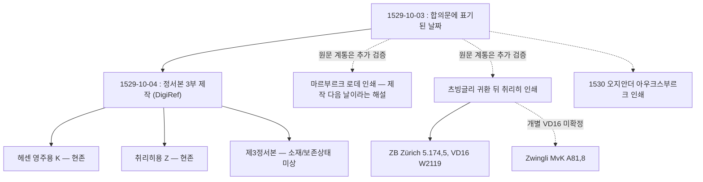

# 종교개혁 ATLAS V2.25 — 마르부르크 1529년: 합의 문안, 정서본, 두 서명본과 인쇄 전승

**연구 브랜치 전용 · Draft · 앱 공개 HOLD**  
**중요 증거 경계:** 이번 환경에서 **1529년 필사본 또는 인쇄본의 원본 판면 직접 읽기 0건**. 이 보고서의 신규 역사적 통찰은 기관 소장 목록과 DigiRef 학술 해설에서 확인한 사실을 결합한 **문서 전승 연구**이지, 원본 필사본의 글자 대조 결과가 아니다.

## 0. 이번 V2.25에 실제로 새롭게 확인한 사실

마르부르크 조항에 대해 DigiRef 학술 해설은 “**10월 4일 제작된 정서본 3부 중 헤센 영주용과 취리히용 2부가 현존**”한다고 명시한다. 취리히용에는 헤센용에 없는 **추가 잎(Ergänzungsblatt)**이 있고, **서명자 그룹의 순서가 다르다**고 설명한다. 필사본의 계통뿐 아니라 **이후의 인쇄·유통**에 대해서도 프란츠 로데의 마르부르크 인쇄, 츠빙글리의 귀환 후 취리히 인쇄, 오지안더의 1530년 아우크스부르크 인쇄까지 언급한다.

출처: [DigiRef 「Die Marburger Artikel」, Clemens Joos 해설 및 소장기록](https://flugschriften.reformationsportal.de/recherche-im-gesamtbestand/listeneinstieg?cHash=b4cace5da9c214d4d23e5163b49d0c2c&tx_joreformation_pi1004listenuebersicht%5Baction%5D=detail&tx_joreformation_pi1004listenuebersicht%5Bcontroller%5D=Mapservice&tx_joreformation_pi1004listenuebersicht%5BjoDel%5D=1&tx_joreformation_pi1004listenuebersicht%5BjoDetailView%5D=stat_showcase_00000023). 기록의 검색 색인에 기초하였으며 원본 이미지 파일은 접근 제한으로 읽지 못했다.

## 1. 합의문의 날짜와 정서본의 제작일: 구분할 이유

| 역사적 층위 | 자료상의 표시 | 확인 상태 |
|---|---|---|
| 합의문의 본문 또는 인쇄된 표제에 붙인 날짜 | **1529년 10월 3일** | 취리히 인쇄본의 서지상 표제 ‘dritten Tags Octobers’, 취리히 문서관 등록일, WA 편집 독일어 본문 서두 |
| 정서본 세 부의 제작 | **1529년 10월 4일** | DigiRef 학술 해설이 세 부를 이 날짜에 제작했다고 명시 |
| MBW 비평목록의 표기 | **3.[4.] Oktober 1529** | [MBW 825](https://melanchthon.hadw-bw.de/regest.html?reg_nr=825)의 해석상 병기 |
| 헤센 K 원본의 기록 날짜 | **4. Oktober 1529** | DigiRef 인덱스 날짜 항목 |
| 마르부르크 최초 인쇄의 시점 | **정서본 제작 ‘다음 날’** | DigiRef 해설. **10월 5일이라는 달력 일자는 이 해설의 전후 문장으로부터 추론**한 것으로, 실제 인쇄본 판권장/간기 판독으로 확인한 것은 아니다 |

여기서 **3일은 합의문에 표기된 날짜**, **4일은 정서본 제작에 대한 학술 서술**, **5일은 후속 인쇄의 추론 날짜**다. 세 날짜를 동일한 '합의가 이루어진 날짜' 필드에 덮어쓰는 오류를 방지해야 한다. 오히려 문서의 서두와 후속 정서 및 출판 시점을 구별하면 독자가 더 쉽게 이해할 수 있다.

## 2. 정서본 세 부의 복잡하지 않지만 중요한 계통

DigiRef 해설을 기초로 다음 관계를 만들었다.

**주의:** 이 그림은 **역사적 유통의 관계**이지, Z 필사본의 글자가 W2119에 그대로 베껴졌다는 엄밀한 사본 계통도(stemma codicum)가 아니다. 인쇄 작업에 사용된 저본, 필사와 인쇄 사이의 교정, 생존 인쇄본의 실제 문구를 비교하기 전에는 필사본 Z → W2119를 직접 복제 관계로 그리지 않는다.

### 헤센 K와 취리히 Z의 물리적 차이

DigiRef는 Z의 **추가 잎**을 명시하고, 취리히 주립문서관은 `E I 3.1 Nr.54`를 **3장의 접지된 이중지와 1장의 단일지**로 설명한다. 취리히 문서관은 또한 Z에 **7·13·15조의 세 추가 문구**가 있으나 K에는 없다고 기재한다.

- 이 두 기록은 독립적이고 서로 양립 가능하다.
- 그러나 Z의 별도 추가 잎이 **세 조항 각각의 추가 구절을 모두 담는지**, 또는 별도 편집·전사 관계인지를 **원본 이미지 없이 단정할 수 없다**.
- 서명본의 실제 철자, 줄 삽입 표시, 해당 조항의 삽입 위치와 수가 확인되지 않았으므로 `z_original_reading`/ `k_original_reading`은 계속 `null`.

취리히 문서관 원본 목록: [Staatsarchiv Zürich E I 3.1 Nr.54](https://suche.staatsarchiv.djiktzh.ch/detail.aspx?ID=618165).

### 서명자 순서 차이가 중요한 이유

DigiRef의 설명에 따르면, **K**에는 비텐베르크 인물들이 먼저 서명하고 남독일 루터파 및 오이콜람파디우스·츠빙글리 등이 뒤따르는 반면, **Z**에는 뒤쪽의 그룹이 먼저 위치한다. 이 설명을 그대로 사료 근거로 남겼다. 서명 순서가 다르다는 것이 **교리의 내용이 달라졌다는 직접 증거**는 아니다. 그러나 동일한 합의문이 정치·지리적으로 다른 당사자에게 제출될 때 **서명 형식과 편집의 맥락이 중요했을 가능성**을 질문할 근거는 된다.

서명자의 손글씨와 순서를 이번 연구자가 직접 보고 확인한 것은 아니므로, 인물별 서명 좌표와 페이지 번호는 아직 생성하지 않는다.

## 3. 1529~1530년 인쇄 전승

DigiRef는 첫 마르부르크 인쇄를 **Franz Rhode**, 취리히 출판을 **츠빙글리 귀환 이후**, 이듬해 아우크스부르크 인쇄를 **Andreas Osiander**의 작업으로 소개한다. 마르부르크 문서가 **21차례 재인쇄되었다**는 수도 덧붙인다. 이 마지막 수치는 학술 해설의 수치이지 이번에 21개 인쇄판을 독립 확인했다는 뜻이 아니다.

<escape></escape>**취리히 소장본 식별에서 새롭게 분명해진 점:** e-rara 검색에는 1529년 같은 제목을 가진 서로 다른 두 소장기호가 나란히 등장한다.

| 소장기호 | 인쇄 관련 표시 | 판본 식별 판정 |
|---|---|---|
| **ZB Zürich 5.174,5** | ‘Getruckt zuo Zürich : durch Christoffel Froschouer’ | **VD16 W2119 확인** (V2.22–24) |
| **ZB Zürich Zwingli MvK A 81,8** | ‘[Zürich] : [Christoph Froschauer d. Ä.]’ | 1529년 별도 소장 항목 **확인**, 정확한 VD16 W2118 귀속은 **미확정** |

e-rara 검색에 **두 항목이 존재한다는 사실**은 명확하지만, 그 자체로 판본마다 제7/13/15조의 본문이 다르다는 뜻은 아니다. 이문 분석은 이미지 비교로 판단해야 한다.

출처: [e-rara 1529년 츠빙글리 관련 검색 결과](https://www.e-rara.ch/search/quick?facets=d100%3D%221500%22+and+d10%3D%221520%22&max=100&query=zwingli&s=date) / [W2119 개별 서지](https://www.e-rara.ch/zuz/content/titleinfo/170052).

## 4. 기존 역사 서술에 무엇이 달라져야 하는가

**기존의 단순한 설명:** “1529년 10월 3일, 루터와 츠빙글리는 15개 조항에 서명했다. 성만찬 문제만 해결하지 못했다.”

**V2.25의 연구용 개선 초안:**

> 1529년 10월 마르부르크 회담 참가자들은 삼위일체, 그리스도의 신성·인성, 믿음과 교회 질서 등 광범위한 신앙 항목에서 공통된 문안을 마련했다. 그 합의문에는 10월 3일이라는 날짜가 전하지만, 한 학술 디지털 아카이브는 이튿날 세 부의 정서본이 만들어졌다고 설명한다. 오늘날 남아 있는 헤센 영주용과 취리히용 서명본은 같은 합의문을 담으면서도 서명 배열과 추가 잎에서 차이를 보인다. 취리히 문서관의 목록은 제7·13·15조에서 취리히본에만 추가 문구가 있다고 기록한다. 얼마 지나지 않아 마르부르크와 취리히에서 인쇄본이 나왔고, 이 합의의 내용은 독일어권 여러 도시로 퍼졌다. 이런 전승의 역사는 15개 조항을 단순히 ‘합의 성공’ 또는 ‘성만찬 때문에 실패’로만 볼 수 없게 한다. 초반 14개 조항의 공통점과 마지막 성만찬 조항의 미해결 문제를 함께 읽어야 하는 이유다.

위 문단은 **연구 전용 설명문**으로 실제 원본 이문 판독·전문가 검토 전에 웹앱에 공개하지 않는다.

### 독자에게 꼭 보여줄 세 가지 포인트

1. **문서의 표기 날짜와 정서본 제작일은 다를 수 있다.** 10월 3일과 4일은 곧바로 모순이 아니다.
2. **같은 합의문도 여러 물리적 형태로 전해진다.** K/Z 두 서명본, 추가 잎, 서명 순서, 그 뒤의 인쇄본은 서로 구별할 대상이다.
3. **전승이 퍼졌다는 사실과 교리적 완전 일치는 다르다.** 공동 신앙의 실질적 범위와 마지막 성만찬 논쟁을 각각 명료하게 설명해야 한다.

## 5. 후속 연구에서 해결해야 할 일곱 가지

- 제3 정서본의 원래 수령자·보존 여부를 독립 사료로 확인.
- 3일/4일의 원문 표기와 정서의 실제 작성일을 원본 또는 인쇄본의 날짜·서명을 통해 확인.
- 취리히 추가 잎과 7·13·15조의 세 후대 추가 기술 사이의 정확한 물리적 관계를 판독.
- W2119 인쇄본이 Z 서명본의 추가 문구를 포함하는지 확인.
- `Zwingli MvK A81,8`의 개별 e-rara 상세 서지를 찾아 W2118과 연결 가능한지 판단.
- DigiRef의 재인쇄 ‘21회’를 독립 서지 목록으로 검증.
- 로데 인쇄의 실제 날짜를 인쇄본 표제·간기와 대조하고 ‘10월 5일’은 우선 추론으로 유지.

## 6. 구현·검증 상태

새 데이터 `data/deep/atlas_v225_marburg_fair_copy_print_transmission.json`는 원고와 분리되어 관리된다. 문서와 인쇄본 **10개 역사적 대상**, 출처 근거가 달린 **10개 전승 관계**, 해설 근거 **7개**, 독자용 섹션 **3개**, 열린 쟁점 **7개**를 저장한다.

V2.19 10편/74절/128문단/543문장/35,102 코드포인트와 V2.20~V2.24 자료는 건드리지 않는다. 신규 원본 파일 다운로드 **0건**, 직접 원본 페이지 판독 **0건**, Z/K 문구별 원본 교감 **0건**, 출판 **0건**.

**다음 V2.26:** (A) 실제 W2119 PDF·IIIF 원본 판면 확보, (B) DigiRef에서 안내하는 이미지를 다른 공개 메타데이터/디지털 저장소로 추적, (C) 제7·13·15조의 인쇄판-필사본 대조 및 근현대 판본 근거로 격상. 원본 확보 실패가 지속될 경우 '검증 실패'만 축적하지 말고 공개된 16세기 판본별 목록·역사적 전승 설명을 더 정밀화한다.
