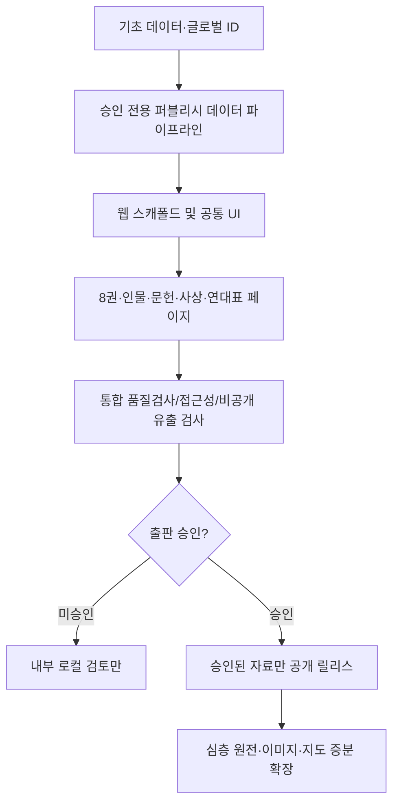

# REFORMATION ATLAS · 구현 TASKLIST V0.1
> 2026-10-25 · **DRAFT. 이 목록은 미래 개발 순서이며 현재 실행 완료한 작업 목록이 아니다.**
> 원칙: 개요 콘텐츠 → 프로젝트 설계 문서 → 웹 MVP → 심층 정보 확장.
> 요구 추적: PRD FR-001~018 전수 연결, TRD/UXUI에서 실제 기능과 데이터 계약 정의.

## 1. 현 상태
- 8권 개요 및 참고 데이터: **127개 콘텐츠 객체 / 32관계**, 학술 전문 승인 아님.
- PROJECT PLAN / PRD / TRD / UXUI / TASKLIST 모두 **초안만** 존재.
- GitHub에 실제 앱 화면/라우터/빌드 배포 코드를 아직 작성하지 않았다.
- `can_ship=false`이며 제3권 미승인 시각자료는 공개 금지.
- 아래 모든 항목 `NOT_STARTED`. 개발 착수는 별도 승인·확정한 범위에서.

## 2. 개발 마일스톤과 의존성

| 코드 | 단계 | 작업수 | 완료 정의 |
|---|---|---:|---|
| A_CONTENT | 역사정보 준비/ID/출처 | 4 | 요구사항/검증 기준 충족 전 DONE 금지 |
| B_PIPELINE | 비공개 데이터 변환 및 승인 게이트 | 4 | 요구사항/검증 기준 충족 전 DONE 금지 |
| C_SCAFFOLD | 웹 토대·공통 컴포넌트 | 3 | 요구사항/검증 기준 충족 전 DONE 금지 |
| D_PAGES | 페이지와 탐색 기능 | 11 | 요구사항/검증 기준 충족 전 DONE 금지 |
| E_QA | 접근성·보안·콘텐츠 통합검증 | 4 | 요구사항/검증 기준 충족 전 DONE 금지 |
| F_RELEASE | 프리뷰/게시 게이트 | 2 | 요구사항/검증 기준 충족 전 DONE 금지 |
| G_DEEP | 심층 콘텐츠 증분 확장 | 4 | 요구사항/검증 기준 충족 전 DONE 금지 |

## 3. 항목별 작업·수용 기준
| ID | 단계 | 선행 | 관련 PRD | 작업 | 확인 기준 | 우선/크기 |
|---|---|---|---|---|---|---|
| AT-001 | A_CONTENT | — | FR-014 | 기존 JSON·개요 소스 고정 및 도메인 필드 정리 | 8권/127개 항목·32관계·23출처 재현; 출처 범위/검토 상태 보존 | P0 / S |
| AT-002 | A_CONTENT | AT-001 | FR-003, FR-014 | PER·OV-P 글로벌 ID 대응표의 정식 마이그레이션 설계 | 발도/위클리프/후스 3명 중복 없이 연결, 33명 전체 충돌 없는 ID 수립 | P0 / M |
| AT-003 | A_CONTENT | AT-001 | FR-005, FR-010 | 문헌 원전/번역/판본 및 출처 등급 정규화 | 문헌 20건 정보 분리, 메타데이터를 원전 직독이라고 표시 금지 | P0 / M |
| AT-004 | A_CONTENT | AT-001 | FR-004, FR-007 | 연대표 날짜 정밀도/장소 좌표 검증 규약 | 정밀도 6종 보존, 미고증 장소 22건 pin=0 | P0 / S |
| AT-005 | B_PIPELINE | AT-002, AT-003, AT-004 | FR-001, FR-002, FR-014 | 읽기 전용 승인 데이터 모델과 파서 | 원본 비파괴 정규화, 필수 키/관계 정합 확인 | P0 / L |
| AT-006 | B_PIPELINE | AT-005 | FR-011, FR-013 | 공개 전용 exporter / 내부 검토 loader 분리 | DRAFT만 있을 때 공개 데이터/검색/이미지 0건, 내부에서만 검토 가능 | P0 / L |
| AT-007 | B_PIPELINE | AT-003, AT-006 | FR-010, FR-011 | 출처·라이선스·이미지 권리 게이트 | 원전/판본/이미지의 승인/근거 부족 시 공용 빌드 차단 | P0 / M |
| AT-008 | B_PIPELINE | AT-005, AT-006 | FR-008 | 정적 검색 데이터 및 별칭 생성 | 한국어/영어 인명 별칭; 유형별 색인, 미승인 항목 누출 0 | P0 / M |
| AT-009 | C_SCAFFOLD | AT-006 | FR-015, FR-012 | 웹 프로젝트 기초/라우터/SSG 빌드 설정 | 프레임워크 선택 기록 및 내부에서 14 화면 라우트 빌드, 운영 배포 없음 | P0 / M |
| AT-010 | C_SCAFFOLD | AT-009 | FR-012 | 디자인 토큰·공통 시멘틱 컴포넌트 | 모바일 최소 320px·글자 크기·대비·포커스 구조, 인물 이미지 없이 동작 | P0 / M |
| AT-011 | C_SCAFFOLD | AT-009, AT-010 | FR-015 | 전역 헤더/내비게이션/브레드크럼 | 14 라우트 간 이동, 직접 링크/브라우저 뒤로가기/키보드 탐색 | P0 / M |
| AT-012 | D_PAGES | AT-005, AT-011 | FR-001 | 홈·8권 카드 목록 | VOL-01~08 카드, VOL-08은 시간대 아닌 주제 아카이브 | P0 / M |
| AT-013 | D_PAGES | AT-012 | FR-002 | 권 상세 템플릿과 섹션 | 8권 요약/인물·사건·문헌·주제 관계, 없는 항목은 명시 | P0 / M |
| AT-014 | D_PAGES | AT-002, AT-011 | FR-003, FR-013 | 인물 목록·개요 상세 | 33개 인물 카드/개요, 안정된 ID 사용, 심층 준비 중 상태 | P0 / M |
| AT-015 | D_PAGES | AT-004, AT-011 | FR-004 | 연대표·사건 상세 | 34개 사건, 연대 근사/범위 텍스트 보존, 필터 정상 | P0 / L |
| AT-016 | D_PAGES | AT-003, AT-011 | FR-005 | 문헌 목록·상세 | 20문헌, 서지·원어명·출처·판본 계층, 유료 전문 비노출 | P0 / M |
| AT-017 | D_PAGES | AT-013, AT-011 | FR-006 | 주제/사상 목록·상세 및 VOL08 네비게이션 | 10개 주제/관련 권, 제8권은 시대 오인 금지 | P0 / M |
| AT-018 | D_PAGES | AT-004, AT-011 | FR-007, FR-013 | 장소 현대 지명 목록·상세 링크 | 22개 지명 목록, 고증 좌표 없음 고지, 지도 오픈 금지 | P0 / S |
| AT-019 | D_PAGES | AT-008, AT-011 | FR-008 | 기본 검색 페이지·유형 필터 | 루터/Martin Luther·후스/Jan Hus·1517 검색, 빈 결과 안내 | P0 / L |
| AT-020 | D_PAGES | AT-007, AT-010 | FR-010 | 출처/근거 패널과 검증 상태 설명 | 직접 원전/번역/서평/기관해설·DRAFT 상태를 정보로 표현 | P0 / M |
| AT-021 | D_PAGES | AT-005, AT-014, AT-016 | FR-009 | 관계 기반 관련 항목 카드 | 32관계 참조 고아 0, 사상 영향=여행 오인 금지 | P0 / M |
| AT-022 | D_PAGES | AT-014, AT-020 | FR-013, FR-014 | 깊이 블록 빈 슬롯/연구 대기 화면 | 심층 자료 미존재시 안내, 후속 승인 블록 삽입 후 URL 불변 | P0 / S |
| AT-023 | E_QA | AT-013, AT-014, AT-015, AT-016, AT-017, AT-018, AT-019, AT-021 | FR-001, FR-002, FR-003, FR-004, FR-005, FR-006, FR-007, FR-008, FR-009, FR-015 | 라우트·교차 링크·검색 통합 테스트 | 총 14 경로/8권·33인물·34사건·20문헌·10주제·22지명 등 카탈로그 연결 정상 | P0 / L |
| AT-024 | E_QA | AT-011, AT-020, AT-023 | FR-012 | 320px~1440px 반응형 및 WCAG 접근성 점검 | 키보드/포커스/읽기 순서/대비/alt/모바일 흐름 검증 | P0 / L |
| AT-025 | E_QA | AT-006, AT-008, AT-023 | FR-011 | 검색 인덱스·정적 산출물 DRAFT 노출 검사 | HTML/JSON/JS/media/sitemap 어디에도 비승인 연구 원본 없음 | P0 / L |
| AT-026 | E_QA | AT-023, AT-025 | FR-012, FR-014 | 기본 성능·보안 헤더·회귀/롤백 계획 | 성능 측정 기록, 배포 재현·이전 버전 복구 시나리오 | P0 / M |
| AT-027 | F_RELEASE | AT-025, AT-026 | FR-011 | 비공개 프리뷰 접근통제 및 배포 설정 검토 | Cloudflare Pages 등 적용 시 preview 기본 공개 차단; 인증 확인 전 DRAFT 배포 금지 | P0 / M |
| AT-028 | F_RELEASE | AT-027 | FR-011, FR-010 | 사람 승인·출판 가능한 콘텐츠의 독립 게시 게이트 | 승인된 콘텐츠만 릴리스 후보에 포함; 인간 승인 없이 main/공개 배포 없음 | P0 / S |
| AT-029 | G_DEEP | AT-002, AT-022, AT-028 | FR-017, FR-014 | 개요→심층 ContentBlock 통합/버전 기록 | 기존 ID/URL 불변, DEEP_RESEARCH 추가/롤백 테스트 | P1 / L |
| AT-030 | G_DEEP | AT-004, AT-028 | FR-016 | 전문 검증된 좌표 기반 지도 P1 | 위경도/시대와 출처·정밀도 검증 후 핀 노출 | P1 / L |
| AT-031 | G_DEEP | AT-021, AT-028 | FR-018 | 관계 그래프·주제별 교육 독해 경로 P1 | 영향/직접 교류 등 관계 타입·원출처를 잃지 않는 그래프 | P1 / L |
| AT-032 | G_DEEP | AT-029 | FR-017 | 위클리프·후스·루터 등 심층 연구 검토 게이트 | 원전/후대 판본/번역/연구 해석 분리, 전문가·권리 승인 블록만 서비스 반영 | P1 / L |

## 4. 구현 원칙
1. **코드보다 정규화/데이터 정합 먼저:** 제3권 기존 인물 ID와 개요 중복을 해결해야 관련 링크와 검색이 안정된다.
2. **정적 파이프라인 전제:** 제안된 Astro/TypeScript는 TRD 잠정 결정이다. 확정 전 다른 프레임워크를 강제하지 않는다.
3. **0개 승인도 정상:** 127개 DRAFT 전부를 공용 빌드에서 자동 공개하지 않는다. 비공개 로컬 프리뷰와 공개 프로덕션 빌드를 엄격히 구분한다.
4. **시간/좌표 고증 별도:** 22개 장소는 실제 중세 현장 좌표가 없음. P0는 목록, 지도 P1.
5. **이미지/저작권 검토:** 공개하려는 새 도판은 원저작·이용권·학술 표현·alt/캡션 체크가 필요하다.
6. **원전 심화는 증분:** 위클리프·후스·루터의 장문은 모든 P0 페이지가 준비된 다음, 기존 ID와 연결해 추가한다.
7. 각 작업을 `DONE`으로 전환할 때 Git commit·자동검사 로그·필요 시 사용자 최종 승인 기록을 남긴다.

## 5. 사람의 확인이 필요한 게이트
- Gate-A: PROJECT PLAN/PRD/TRD/UXUI/TASKLIST의 핵심 범위와 기술 선택 확정.
- Gate-B: 실제 앱 개발 시작/기술 스택/개발 저장소 구조 선택.
- Gate-C: 내부 검토 환경 접근통제 확인.
- Gate-D: 공개하기로 결정한 역사 개요/이미지/문헌의 검증·권리·출판 승인.
- Gate-E: 심층 연구/지도/관계 도식이 기존 페이지에 추가될 때 별도 검증.
- 제3권 Draft PR #2와 연구용 기록을 공개 승인으로 승격하지 않는다.

## 6. 다음 실제 개발 착수 순서
- `AT-001~008`: 데이터 정합 및 승인/비승인 파이프라인.
- `AT-009~012`: 웹 스캐폴드·디자인 토큰·홈/8권 첫 화면(로컬 전용).
- `AT-013~022`: 탐색 화면과 사용자 흐름.
- `AT-023~028`: 통합 QA·보안·출판 게이트.
- `AT-029~032`: 심층 연구와 고증 지도/관계 그래프.

**주의:** 작업의 순서와 완료 조건을 정했다는 뜻이지, 실제 웹 코드를 생성하거나 배포했다는 뜻이 아니다.

## 7. 부록 — 개발 작업 메타데이터
- 관리 데이터: `data/overview/atlas_tasklist_v01.json`
- 각 항목: `id,phase,title,depends_on,requirement_ids,acceptance,owner_role,priority,size,status`.
- TASKLIST의 원본과 GitHub 커밋을 연동해 향후 개발 세션에서 완료/진행/차단을 업데이트.
- 요청했던 문서 계획 순서와 동일: `PROJECT_PLAN → PRD → TRD → UX/UI → TASKLIST`.

**판정: `TASKLIST_DRAFT_READY / WEB_CODE_NOT_CREATED / PUBLICATION_NOT_APPROVED`.**
