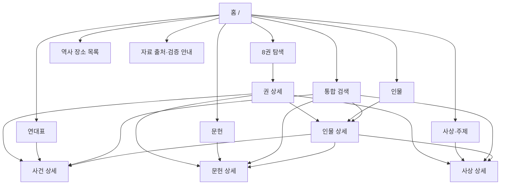

# REFORMATION ATLAS — UX/UI 정보구조·와이어프레임 V0.1
> 2026-10-25 · **DRAFT / 실행 웹 코드 없음 / 시각 디자인 확정 아님**
> 상위 입력: `ATLAS_PROJECT_PLAN_V01.md`, `ATLAS_PRD_V01.md`, `ATLAS_TRD_V01.md`.

## 1. 화면이 전달해야 할 경험
방문자는 첫 화면에서 종교개혁/교회사 8권의 흐름을 즉시 이해하고, 인물·연대·문헌·사상 사이를 자연스럽게 오갈 수 있어야 한다. 제3권의 심층 연구가 아직 완성된 공개 원전 교감본이라는 오해 없이 **개요 → 검증된 심층 → 원전/학술 서지**의 깊이 차이를 직관적으로 구분하도록 한다.

기본 한국어, 원어 명칭은 병기한다. 교회사 전공자가 아닌 방문자도 신학 용어를 검색할 수 있는 구조를 우선한다.

## 2. 사이트맵


**제8권 예외:** 연대표의 뒤에 오는 시대가 아니다. 원문/번역/연구/인물을 교차하는 **사상·문헌 아카이브**로 표시한다. 지도는 P1, P0 장소는 **현대 지명 목록**.

## 3. 템플릿 와이어프레임
### WF-01 홈 / Desktop
```text
┌─────────────────────────────────────────────────────────────────┐
│ 로고/종교개혁 아틀라스       [8권] [인물] [연대표] [문헌] [주제] [검색] │
├─────────────────────────────────────────────────────────────────┤
│ 종교개혁을 입체적으로 읽다                                 자료 안내│
│ 시대·인물·문헌·사상의 연결을 찾아가는 역사 아카이브       [시작하기] │
├─────────────────────────────────────────────────────────────────┤
│ [VOL01] [VOL02] [VOL03] [VOL04]                                   │
│ [VOL05] [VOL06] [VOL07] [VOL08: 사상·문헌 자료실]                 │
├─────────────────────────────────────────────────────────────────┤
│ 주요 탐색        [인물 검색] [역사 연대표] [문헌과 주제]           │
│ 연구 상태 안내: 개요 자료/검증 대기/심층 자료가 구분됩니다         │
└─────────────────────────────────────────────────────────────────┘
```

### WF-02 인물 상세 / Desktop
```text
[홈 > 제4권 > 인물 > 마르틴 루터]
┌──────────────────────────────────┬─────────────────────┐
│ 마르틴 루터 / Martin Luther       │ 관련 인물·사건        │
│ 1483–1546 · 개요 자료            │ 1517년 논쟁           │
│ 활동 요약(2~4문단)                │ 1521년 보름스        │
│                                  │ 95개조 논제           │
│ [개요] [심층 연구(준비 중)]       │ 관련 주제·문헌        │
├──────────────────────────────────┴─────────────────────┤
│ 대표 문헌 · 관련 사건 · 사상 관계(관계 유형을 명확히 표기)         │
├────────────────────────────────────────────────────────────────┤
│ 출처·판본·검증 상태 · 현대 상상 이미지 사용 시 별도 고지           │
└────────────────────────────────────────────────────────────────┘
```

### WF-03 연대표 / Desktop
```text
[홈 > 연대표]
[권 필터 ▼] [시대 필터 ▼] [정확/근사 연대 구분] [검색]
  │ 1415-07-06    얀 후스 처형            [제3권/출처]
  │ 1420년 전후   프라하 4개조           [근사 연대]
  │ 1517년       면벌부 논쟁            [제4권]
  │ 1530년       아우크스부르크 신앙고백 [문헌]
  │ 1784년       한국 천주교 초기 공동체 [제7권]
```
정렬용 연도는 `date_label`을 대체하지 않으며, 화면은 **정확 일자·연도·대략·기간**을 텍스트로 함께 보여준다.

### WF-04 검색 / Desktop
```text
[검색어: 성찬                                       [검색]]
[전체] [인물] [사건] [문헌] [사상] [권 필터]
검색 결과: 자료유형 + 명칭 + 짧은 설명 + 시대/검토 상태
  [주제] 성찬론           관련 인물/문헌 (제8권 자료실)
  [인물] 존 위클리프     저술 영향/논쟁
  [문헌] ...             원문/번역/학술 개설의 종류 표시
검색 결과 없음 → 다른 표기/관련 주제 제안
```

### WF-05 Mobile 390px
```text
┌────────────────────────┐
│ 아틀라스   [검색] [메뉴] │
├────────────────────────┤
│ 종교개혁을 읽다         │
│ 시대·인물·사상 탐색     │
│ [시작하기]             │
├────────────────────────┤
│ 1권 초대교회            │
│ 2권 중세교회            │
│ 3권 선구자              │
│ ...                    │
│ 8권 사상·문헌 자료실   │
├────────────────────────┤
│ 출처와 검증 상태 안내   │
└────────────────────────┘
```
검색·내비게이션은 키보드 및 스크린리더 사용 가능해야 한다. 모바일에서 화면 폭 때문에 역사 연대나 원어명칭이 잘리면 가로 스크롤 대신 줄바꿈 또는 대체 제목을 제안한다.

## 4. 상세 페이지 공통 레이아웃
1. **상단**: Breadcrumbs, 제목(한국어), 원어 표기, 시대·해당 권.
2. **핵심 개요**: 2~4개 문단, 가능하면 30초 내 대강의 의미 파악.
3. **탐색 카드**: 사건·인물·문헌·주제 관계. 관계 의미가 모호한 선/화살표 대신 명시적 텍스트 라벨.
4. **심층 슬롯**: 현재 내용이 없으면 '심층 자료 준비 중', 있으면 버전/검증 수준별 접기·펼치기 또는 분절.
5. **출처 패널**: 직접 원전/후대 편집/번역/학술서평/기관 해설을 구분. 클릭 시 관련 출처 링크.
6. **시각자료**: 승인된 것만 사용, AI 상상화는 가시적인 고지 + alt/캡션 필수.

## 5. 구성 요소 및 화면 재사용
| 컴포넌트 | 용도 | P0/P1 |
|---|---|---|
| `CMP-01` SiteHeader | 전역 내비게이션·검색 바로가기 | P0 |
| `CMP-02` VolumeCard | 권/시대/주제 소개·권 상세 이동 | P0 |
| `CMP-03` EntityCard | 인물·사건·문헌 요약 및 출처 개수 | P0 |
| `CMP-04` EvidencePanel | 자료 출처/서지/근거 접근 수준 | P0 |
| `CMP-05` ResearchStatus | 개요/심층/검증 대기와 이미지 상상 고지 | P0 |
| `CMP-06` RelatedItems | 타입이 있는 인물/사건/문헌 연결 | P0 |
| `CMP-07` TimelineEntry | date_label 보존·정밀도·사건 연결 | P0 |
| `CMP-08` FilterSearch | 한국어·원어별칭, 유형/권 필터 | P0 |
| `CMP-09` EmptyState | 현재 자료 없음·검증 대기·오류와 대체 탐색 | P0 |
| `CMP-10` Breadcrumbs | 이동 경로·현재 페이지 표시 | P0 |
| `CMP-11` DeepResearchSections | 같은 URL에 추가되는 심층 연구 섹션 | P1 |
| `CMP-12` EvidenceMap | 검증된 좌표만 표시하는 지도 | P1 |

## 6. 반응형·접근성 규칙
| 화면 | 초안 화면 패턴 | 수용 기준 |
|---|---|---|
| 320~767px | 1열 스택/모바일 메뉴/전체 폭 검색 | 320px에서도 수평 정보 유실 최소화, 터치 타깃/포커스 확인 |
| 768~1023px | 2열 카드, 명칭 길이에 따라 적응 | 필터/카드가 읽기 순서에 맞게 이동 |
| 1024px 이상 | 최대 너비가 제한된 읽기 콘텐츠 + 보조 관련 정보 | 대각선 눈 이동을 줄이는 문단 너비, 대비/위계 일관성 |

접근성 목표 WCAG 2.2 AA. 색상만으로 연구 승인 여부를 구별하지 않으며 **문장 + 상태**로 제공한다. 모든 링크는 읽을 수 있는 이름을 갖는다.

## 7. 색·서체·레이아웃 스타일 제안 (확정 전)
- **톤:** 현대적 아카이브, 학문적 신뢰감, 친숙한 안내.
- **배경:** 밝은 중성 계열, 텍스트: 짙은 차콜/네이비, 강조: 절제된 테라코타 또는 청록. 대비는 실제 시안에서 검사한다.
- **제목:** 문헌적 분위기의 세리프 서체 후보; **본문:** 한국어 가독성이 높은 산세리프.
- **이미지:** 기본은 도판 삽입 전 안전한 텍스트 중심 카드. 역사 초상·지도는 입증된 자료/자체 제작 이미지가 승인된 때만 표시.
- 컬러·폰트·이미지 에셋은 **실제 지정/제작 전**이고 현재 정본 아님.

## 8. 비공개 연구 자료 UI 처리
- PRD와 TRD의 공개 게이트를 준수한다. `DRAFT` 연구 콘텐츠의 내부 프리뷰는 `로컬 서버` 또는 접근통제 뒤에만 제공.
- 정적 빌드 시 미승인 인물화·지도·원전 전문이 클라이언트 번들/검색 인덱스에 포함되지 않도록 한다.
- **상태 표시**는 실제 독자가 이해할 수 있는 `개요`, `출처 검토 중`, `심층 자료 준비 중`, `승인된 심층 자료`처럼 표현하되 원본 `review_status`와 연결해야 한다.
- 외부 공개 전 승인 항목이 없으면 UI 템플릿 확인용 예제 데이터만 내부에서 사용하고 역사 콘텐츠의 공개를 꾸며내지 않는다.

## 9. 사용자 테스트 시나리오
- **JRN-01**: `/` → /volumes → /volumes/VOL-04 → /people/:personId → /documents/:documentId. 루터 개요부터 면벌부 문헌까지 이동.
- **JRN-02**: `/search` → /topics/:topicId → /people/:personId. 성찬론 관련 인물/관점 비교.
- **JRN-03**: `/volumes/VOL-07` → /timeline → /events/:eventId. 한국 교회사 1784/1884/1885 등 연대 구별.
- **JRN-04**: `/places` → /volumes/VOL-03. 현대 도시 목록 이해와 미검증 지도 핀 비표시.
- **JRN-05**: `/people/:personId` → /documents/:documentId. 후스 원저작과 후대 번역의 근거 구분.

## 10. 다음 TASKLIST에 넘길 산출물
- IA 9개 영역/14개 PRD 화면 경로, 모바일·데스크톱 템플릿.
- 공통 컴포넌트 12종 및 접근성/출처·검증 배지 계약.
- 실제 지도는 P1; P0 장소 22건 텍스트 목록과 고증 대기 상태.
- 5개 대표 사용자 여정과 빈 자료/미승인 자산의 UI 상태.
- 이미지 편집, 도판 작업, 캐릭터 제작, 실제 사이트 개발은 수행하지 않음.

**상태: `UXUI_DRAFT_READY`, 승인 대기, `TASKLIST_NOT_STARTED`, `WEB_MVP_NOT_STARTED`.**
