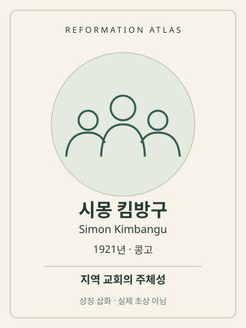
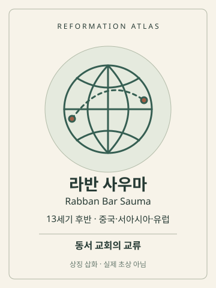
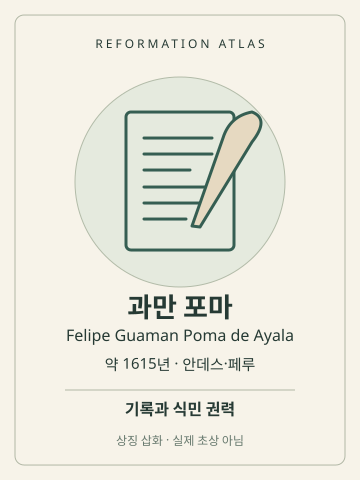
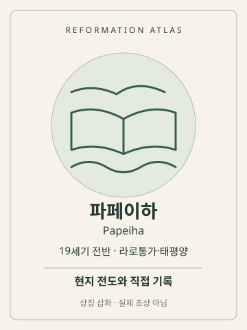
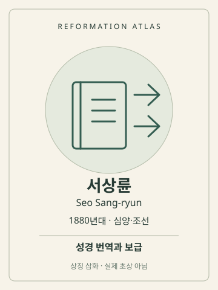
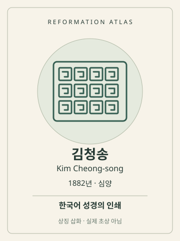
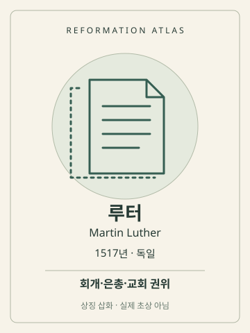
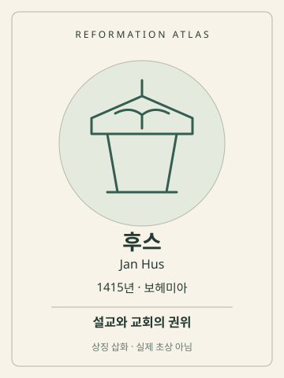
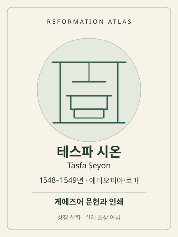
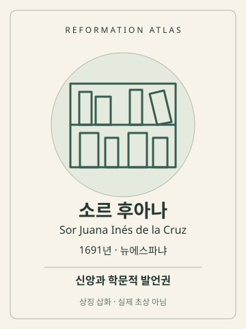

# V5.35 인물 아카이브 1차

> 10명. 초상 근거와 업적을 별도 기록. 외부 초상 파일은 복제하지 않음. 카드 이미지는 실제 인물 얼굴이 아닌 직접 작성한 SVG 상징 삽화.

## 시몽 킴방구 (Simon Kimbangu)

1921년 · 콩고 · 지역 교회의 주체성

1921년 식민지 콩고에서 설교와 치유 활동을 시작했다. 이후 그를 따르는 종교공동체가 성장했다. 지역의 기독교인이 독자적으로 신앙공동체를 조직하는 역사에 주목한다.

초상 근거: 아프리카박물관 전시 이미지 및 1921년 관련 기록. 사진 원본 촬영자와 권리 미확정.

관련 콘텐츠: L448-07-01 / GL534-01

- https://independance.africamuseum.be/en/exhibition/independance/independance-resistances
- https://api2.archives.africamuseum.be/agents/people/1841

---

## 라반 사우마 (Rabban Bar Sauma)

13세기 후반 · 중국·서아시아·유럽 · 동서 교회의 교류

동방교회 수도자로 중국에서 서아시아를 거쳐 1287~1288년 유럽에서 외교 사절로 활동했다. 후대 전기 자료에는 사절 보고와 여행자의 기억이 엮여 있다.

초상 근거: 신뢰할 수 있는 생전 초상 확인 미완료. 여행 경로 도식도 직접 경로로 단정하지 않음.

관련 콘텐츠: L448-02-01 / GL534-02

- https://arpi.unipi.it/handle/11568/1064678

---

## 과만 포마 (Felipe Guaman Poma de Ayala)

약 1615년 · 안데스·페루 · 기록과 식민 권력

글과 그림을 통해 식민 통치와 성직자의 행위를 비판했다. 연대기의 자기 묘사는 저자가 자신을 어떻게 보여 주려 했는지 살피는 자료이기도 하다.

초상 근거: GKS 2232 4° 연대기 내 자화상 연구 확인. 실물 외형의 사진 같은 증거가 아님.

관련 콘텐츠: L448-05-03 / GL534-04

- https://www.kb.dk/en/find-materials/collections/manuscript-collection/chronicle-guaman-poma
- https://www.cambridge.org/core/journals/americas/article/abs/fashioning-a-prince-for-all-the-world-to-see-guaman-pomas-selfportraits-in-the-nueva-coronica/30963B4056E0CA9DF2ABFE9F92F92117

---

## 파페이하 (Papeiha)

19세기 전반 · 라로통가·태평양 · 현지 전도와 직접 기록

라로통가의 기독교 전래를 자신의 언어로 기록한 태평양 전도자이다. 약 1830년의 필사본에 대한 현대 번역·주석 연구가 존재한다.

초상 근거: 필사본 목록과 번역 연구는 외형의 증거가 아님.

관련 콘텐츠: L448-06-03 / GL534-05

- https://natlib.govt.nz/records/22320547
- https://natlib.govt.nz/records/49798915

---

## 서상륜 (Seo Sang-ryun)

1880년대 · 심양·조선 · 성경 번역과 보급

로스 등과 한국어 성경 번역·식자·인쇄·보급에 참여했다. 이후 솔내에서 전도와 공동체 형성에 관여했다. 정확한 최초 교회 창립 기준은 별도 검토한다.

초상 근거: 이번에 생전 사진 원본과 이용 조건을 확정하지 못함.

관련 콘텐츠: L448-07-02 / GL534-06

- https://encykorea.aks.ac.kr/Article/E0027845

---

## 김청송 (Kim Cheong-song)

1882년 · 심양 · 한국어 성경의 인쇄

1882년 한국어 복음서 인쇄에서 식자공으로 협력했다. 성경 번역의 성과가 언어 지식과 실제 제작 기술을 가진 여러 사람의 협업이었다는 점을 드러낸다.

초상 근거: 개인 생몰연도·초상·구체적 작업 장면을 확정하지 않음.

관련 콘텐츠: L448-07-02 / GL534-06

- https://encykorea.aks.ac.kr/Article/E0037972
- https://encykorea.aks.ac.kr/Article/E0037229

---

## 루터 (Martin Luther)

1517년 · 독일 · 회개·은총·교회 권위

면죄부와 회개에 관한 논쟁으로 교회 가르침과 권위 문제를 공론화했다. 신앙고백과 도시·영방 교회 제도의 변화는 루터 개인의 행위와 구분해 읽는다.

초상 근거: 루카스 크라나흐 1529년 초상 소장기관 설명. 디지털 이미지 권리는 이 작업에서 별도 승인하지 않음.

관련 콘텐츠: L448-04-01 / L448-04-01

- https://museopoldipezzoli.it/en/scopri/collezioni/capolavori/opera/portrait-of-martin-luther/
- https://bookofconcord.org/augsburg-confession/

---

## 후스 (Jan Hus)

1415년 · 보헤미아 · 설교와 교회의 권위

교회의 권위와 성직자의 생활을 둘러싼 논쟁에 참여했다. 위클리프와의 영향 관계가 두 사람의 신학이 동일했다는 의미는 아니다.

초상 근거: Met의 Christoffel van Sichem I 초상은 후대 제작. 동시대 초상 없음이라는 박물관 관계자 설명도 확인.

관련 콘텐츠: L448-03-02 / L448-03-02

- https://www.metmuseum.org/art/collection/search/376383
- https://english.radio.cz/where-truth-and-legend-meet-jan-hus-konstanz-8855767

---

## 테스파 시온 (Täsfa Ṣeyon)

1548–1549년 · 에티오피아·로마 · 게에즈어 문헌과 인쇄

로마에서 에티오피아 수도자들과 게에즈어 신약 출판을 추진했다. 유럽 종교개혁과 동시대의 별도 기독교 지식 생산으로 읽는다.

초상 근거: 인쇄본은 확인 가능하지만 외형 자료는 확정하지 않음.

관련 콘텐츠: L448-04-01 / L448-04-01

- https://blogs.loc.gov/international-collections/2020/06/the-1548-ethiopic-gospel-in-print/
- https://www.cambridge.org/core/journals/itinerario/article/an-ethiopian-scholar-in-tridentine-rome-tasfa-seyon-and-the-birth-of-orientalism/905FECD0B24DA673550273B8CAF22D90

---

## 소르 후아나 (Sor Juana Inés de la Cruz)

1691년 · 뉴에스파냐 · 신앙과 학문적 발언권

수녀이자 저술가로 학문과 여성의 지적 활동을 둘러싼 문제를 논증했다. 1691년 작성과 1700년 첫 인쇄 및 1701년 재인쇄의 판본 구분을 유지한다.

초상 근거: 카브레라의 약 1750년 초상은 사후 제작이며 현대 사진의 이용권은 별개.

관련 콘텐츠: L448-05-03 / L448-05-03

- https://smarthistory.org/cabrera-portrait-of-sor-juana-ines-de-la-cruz/
- https://www.inah.gob.mx/boletines/el-inah-y-la-unam-examinan-iconico-retrato-de-sor-juana-realizado-por-miguel-cabrera

